| *Nama* | Yesi Jelita Sinaga |
| *NIM* | 241401071|
| *Lab* | 4|

### Quizly
### Deskripsi Singkat
Quizly adalah aplikasi kuis untuk menguji pemahaman 10 mata kuliah Ilmu Komputer. Setiap subject berisi 10 soal pilihan ganda dengan timer 30 detik per soal. Pengguna dapat melihat hasil beserta kunci jawaban, memantau riwayat dan statistik, mengganti tema tampilan, serta mengadu kecepatan dan ketepatan menjawab lewat Race Mode.

### Fitur
- *Splash screen* animasi dengan teks "Quizly" yang bergerak naik turun.
- *Autentikasi lokal*: Register dan Login dengan validasi form. Data tidak memakai database.
- *10 subject kuis* dalam beberapa kategori (Fundamental, Core, Advanced), dengan filter kategori di Home dan pencarian di halaman Subjects.
- *Kuis berwaktu*: 10 soal per subject, timer 30 detik per soal, dan konfirmasi saat keluar di tengah kuis.
- *Halaman hasil* berisi skor, badge pencapaian, dan kunci jawaban per soal.
- *Statistik di Home*: jumlah kuis, rata-rata skor, streak, dan Recent Activity.
- *Riwayat (History)* semua kuis, termasuk race dengan badge **RACE**, nama lawan, dan hasil (Win/Lose/Draw/Forfeit).
- *Race Mode** 1 lawan 1: buat room dengan kode 6 karakter atau gabung dengan kode, pilih subject, hitung mundur, lalu berlomba. Skor dihitung dari ketepatan dan kecepatan (benar = 100 poin + bonus kecepatan hingga 50 poin). Keluar di tengah race membuat lawan menang otomatis.
  > Catatan: lawan pada versi ini belum _real-time_
- *Pemilihan tema*: 5 palet (Ocean, Campfire, Mars Escape, Forest, Sneaky Cat) dengan background gambar, ditambah mode terang dan gelap.
- *Profil pengguna*: tambah, ubah, dan hapus foto profil dari galeri.
- *Tampilan adaptif dan responsif*: jumlah kolom menyesuaikan lebar layar, dan menu navigasi berpindah dari bawah ke samping pada layar lebar.

## Teknologi
- Flutter (Dart SDK `^3.13.2`)
- Package: `google_fonts`, `image_picker`, `cupertino_icons`
- State management: `setState` untuk state lokal, dan `ChangeNotifier` (`ThemeController`) untuk tema
- Data: lokal dan dummy (tanpa database)

## Struktur Proyek
lib/
├── main.dart
├── models/
│   ├── question.dart
│   ├── quiz_history.dart
│   └── subject.dart
├── screens/
│   ├── splash_screen.dart
│   ├── welcome_screen.dart
│   ├── login_screen.dart
│   ├── register_screen.dart
│   ├── main_navigation_screen.dart
│   ├── home_screen.dart
│   ├── subjects_screen.dart
│   ├── quiz_screen.dart
│   ├── result_screen.dart
│   ├── history_screen.dart
│   ├── profile_screen.dart
│   ├── race_lobby_screen.dart
│   ├── race_screen.dart
│   └── theme_picker_sheet.dart
├── theme/
│   ├── app_theme.dart
│   └── theme_controller.dart
└── widgets/
    ├── custom_button.dart
    └── option_card.dart
assets/
└── images/themes/

## Cara Menjalankan
```bash
git clone <url-repository>
cd quizly
flutter pub get
flutter run
```

Untuk mencoba tampilan tablet atau web:
```bash
flutter run -d chrome
```

## Dokumentasi

### Credit Aset
| Aset | Sumber |
|---|---|
|Google Fonts|
| Ikon | Material Icons |
| Gambar tema Ocean | https://pin.it/1veb45XDQ |
| Gambar tema Campfire | https://pin.it/1lbSYcWuY) |
| Gambar tema Mars Escape | https://pin.it/k3zFDKr25 |
| Gambar tema Forest | https://pin.it/5ysEA3aQa |
| Gambar tema Sneaky Cat | https://pin.it/5fB5DYoIH) |

### Screenshot Halaman
| Halaman | Screenshot |
|---|---|
| Splash | 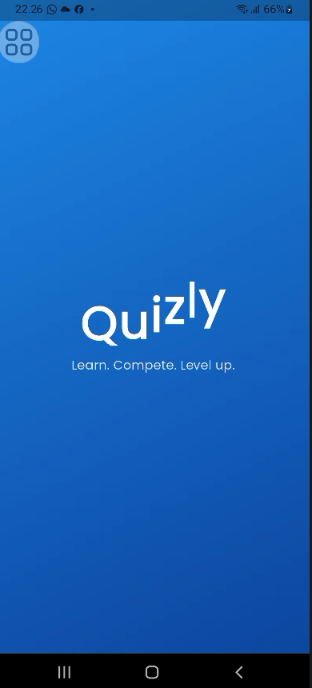 |
| Login | 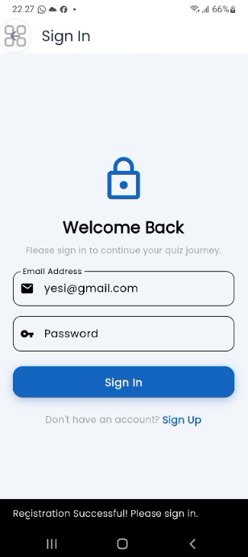 |
| Register | 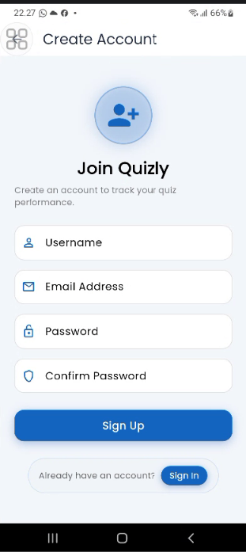 |
| Home | 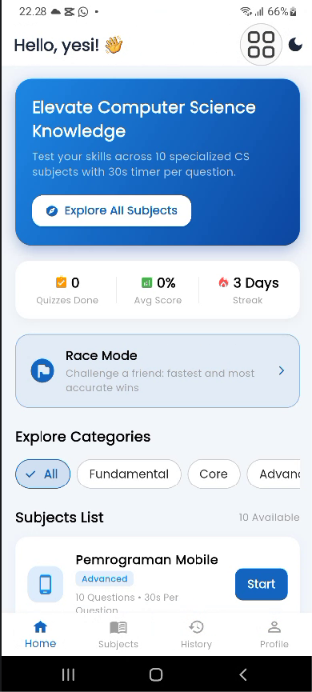 |
| Subjects | 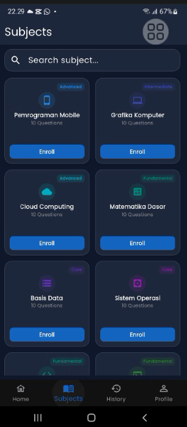 |
| Quiz | 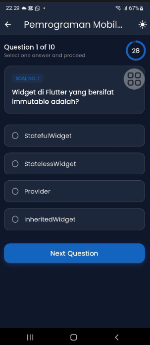 |
| Result | 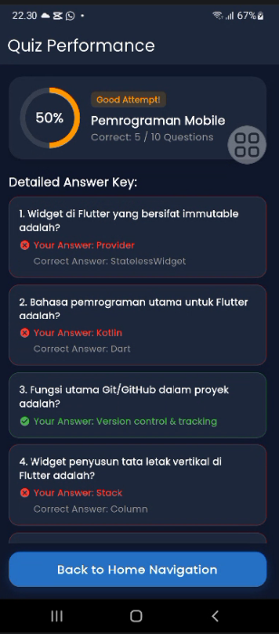 |
| History | 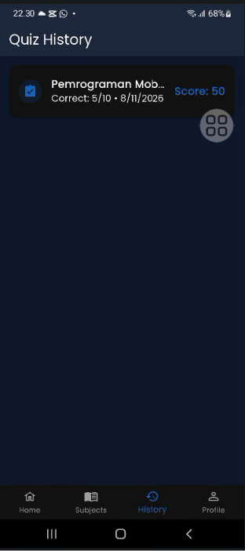 |
| Profile | 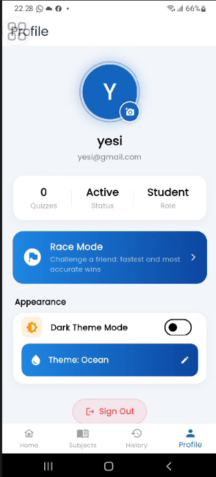 |
| Pilihan Tema | 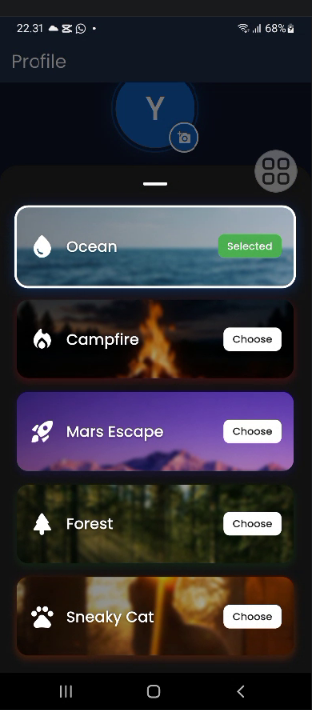 |
| Race Lobby | 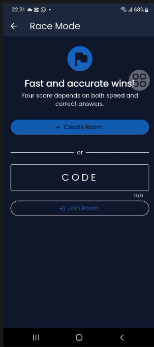 |
| Race | 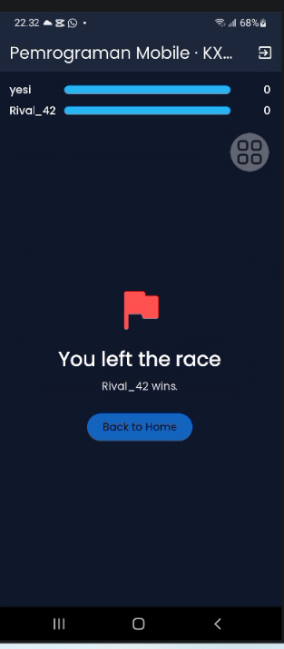 |

### Mockup / Prototype
Link: https://www.figma.com/design/qk5nKiZlbA7wqbUpb0ies8/quizly?node-id=2-2&t=NBxVInCuHgw3KNtc-1

## Pemenuhan Kriteria UTS
| Kriteria | Implementasi |
|---|---|
| StatelessWidget dan StatefulWidget | `ResultScreen`, `OptionCard`, `CustomButton` (Stateless); `HomeScreen`, `QuizScreen`, `RaceScreen`, dan lainnya (Stateful) |
| Minimal 2 halaman dan navigasi | `Navigator` dan `BottomNavigationBar` / `NavigationRail` |
| Reusable widget di file terpisah | `lib/widgets/option_card.dart`, `lib/widgets/custom_button.dart` |
| Aset gambar / ikon | Gambar tema di `assets/images/themes/` dan Material Icons |
| Font kustom | Poppins |
| Ukuran UI dinamis | `MediaQuery`, `LayoutBuilder`, `Expanded`, jumlah kolom dihitung dari lebar layar |
| State management | `setState` dan `ChangeNotifier`; jawaban tidak hilang saat layar dirotasi |
| Tanpa database | Data dummy dan penyimpanan di memori |
| Dual-theme (bonus) | Mode terang/gelap dan 5 palet tema |
| Adaptive dan responsive (bonus) | Menu bawah menjadi menu samping dan jumlah kolom bertambah pada layar lebar |
